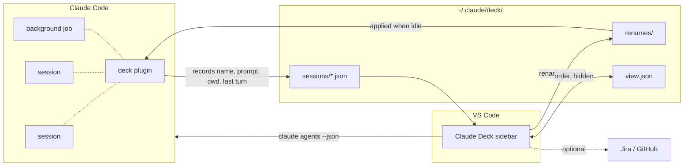
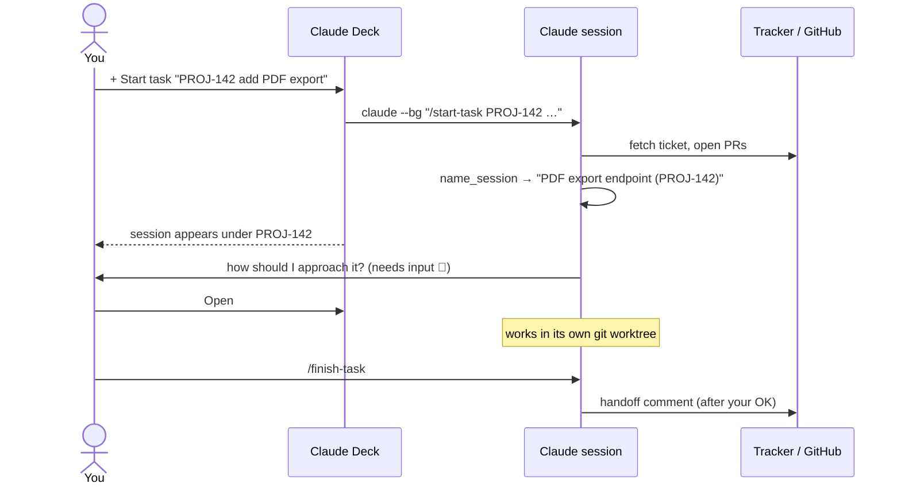

<p align="center">
  
</p>

<p align="center">
  <a href="LICENSE"></a>
  
  
  
</p>

<p align="center">
  <b>Run five Claude Code sessions at once without losing track of any of them.</b><br>
  Claude Deck puts every background and interactive session in one VS Code sidebar, grouped by the ticket it works on,<br>
  with live status, ticket status, open PRs and a ping when a session needs you.
</p>

---

## Why

Claude Code is great at working in the background. Start a few `claude --bg` jobs, open a couple of interactive sessions, and twenty minutes later you have no idea which one is waiting for approval, which one is done, and which terminal tab belongs to which ticket.

Claude Deck is the overview: **one list, grouped by ticket, that tells you what each session is doing and takes you there in one click.**

<p align="center">
  
  <br><sub>Illustration with sample data</sub>
</p>

## Features

| | |
|---|---|
| 🗂️ **Grouped by ticket** | Sessions named `… (PROJ-123)` gather under their ticket; everything else sits below a divider. |
| 🚦 **Live status** | Working, needs input, idle, failed, done, straight from `claude agents`. |
| 🔔 **Needs-input alerts** | A notification with an **Open** button the moment a session waits for you, even with the sidebar closed. |
| 🖱️ **One click to jump in** | Attaches a background job in an editor tab, focuses the terminal of an interactive one, or resumes an ended one. |
| ⏱️ **Prompt cache countdown** | `cache 4:12` shows how long until a session's prompt cache goes cold, so you know when replying is cheap. |
| 🎫 **Ticket status & PRs** | Jira status and open GitHub PRs per ticket (optional). |
| ✏️ **Rename from the sidebar** | Even for running sessions; the plugin applies it once the session is idle. |
| 🧹 **Self-tidying** | Closed tickets and sessions quiet for a week move to History. Drag to reorder; the order is shared across windows. |
| 🔎 **Search** | Find any session, including History, by name, ticket key or title. |

## How it works

Claude Deck has two halves that talk through small files in `~/.claude/deck/`:



- The **`deck` plugin** runs inside every Claude Code session. It writes one tiny JSON file per session and applies renames the sidebar asks for. It never touches transcripts.
- The **VS Code extension** merges those files with `claude agents --json --all` and renders the deck.

## The ticket workflow

The plugin also ships three skills that make sessions ticket-aware. They're optional, and meant as a starting point for your own workflow.



| Skill | What it does |
|---|---|
| `/start-task [KEY] <task>` | Fetches the ticket, names the session `<summary> (KEY)`, asks how to approach the task, creates git worktrees on demand |
| `/finish-task [KEY]` | Drafts a handoff comment (status, acceptance criteria, PRs, tests) and posts it once you approve |
| `/cleanup-worktrees` | Removes worktrees whose PR is merged or closed |

## Install

**1. The Claude Code plugin**

```text
/plugin marketplace add kaiketsu-labs/claude-deck
/plugin install deck@claude-deck
```

or load it from a checkout with `CLAUDE_CODE_PLUGIN_DIRS=/path/to/claude-deck/plugin`.

**2. The VS Code extension**

```bash
git clone https://github.com/kaiketsu-labs/claude-deck
cd claude-deck/vscode
python3 package.py && code --install-extension claude-deck-0.1.0.vsix --force
```

No npm needed: `package.py` zips the extension into a `.vsix`.

**3. Open the deck** from the activity bar. That's it. Ticket status and PRs are optional, see below.

## Configuration

Settings are read from the `env` blocks of `~/.claude/settings.json` and the workspace's `.claude/settings.json` / `settings.local.json`, the same env your Claude sessions see.

| Variable | Effect |
|---|---|
| `TICKET_PROJECTS` | Comma-separated project keys, e.g. `PROJ,OPS`. Only these count as tickets (case-insensitive). Default: any `ABC-123` key. |
| `JIRA_URL`, `JIRA_TOKEN` | Ticket status and titles from Jira (one JQL search a minute). Tickets closed in Jira move to History. |
| `gh` CLI, logged in | Open PRs whose title names the ticket key (every two minutes). |
| `CLAUDE_CODE_PROMPT_CACHE_TTL=1h` or `ENABLE_PROMPT_CACHING_1H` | Cache countdown uses one hour instead of five minutes. |

Without Jira or `gh` everything else still works; tickets just show no status.

## Make it yours

- **Your own workflow:** copy the skills into `~/.claude/skills/` and change anything. The sidebar only relies on sessions being named `<summary> (<KEY>)`, which the plugin's `name_session` tool does for you.
- **No tickets at all?** Fine. Sessions without a key are listed below the divider, with status, alerts and the cache countdown.

## Roadmap

- [ ] Pluggable trackers: GitHub Issues, Linear, plus a `command` adapter for anything else
- [ ] Configurable start command and ticket pattern in VS Code settings
- [ ] macOS / Windows: focus the terminal of interactive sessions (Linux only today)
- [ ] VS Code Marketplace & Open VSX release

## Files

| Path | Written by | Contents |
|---|---|---|
| `~/.claude/deck/sessions/<id>.json` | plugin | name, first prompt, cwd, start and last turn time |
| `~/.claude/deck/renames/<id>` | sidebar | pending rename, removed once applied |
| `~/.claude/deck/view.json` | sidebar | manual order and History overrides |
| `~/.claude/deck/ticket-titles.json` | plugin | short ticket titles shown beside keys |

## Development

```text
claude-deck/
├── plugin/          Claude Code plugin "deck": hooks + skills
│   ├── hooks/       session recorder, name_session / set_ticket_titles tools
│   └── skills/      start-task, finish-task, cleanup-worktrees
└── vscode/          VS Code extension (plain JS, no build step)
```

```bash
cd vscode && node --test
```

Issues and PRs welcome.

## License

[MIT](LICENSE). Not affiliated with Anthropic. Claude and Claude Code are trademarks of Anthropic.
