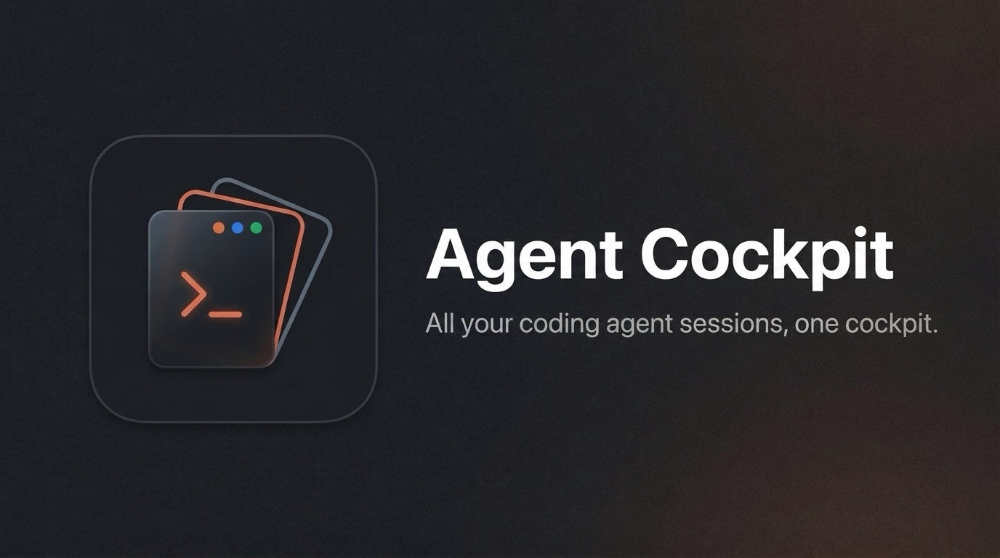
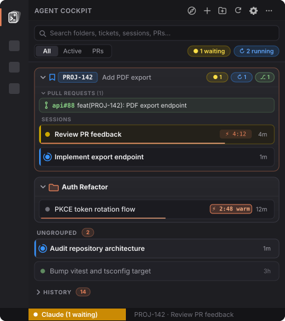

<p align="center">
  
</p>

<p align="center">
  <a href="LICENSE"></a>
  
  
  
</p>

<h3 align="center">
  Run five Claude Code sessions in parallel without losing track of a single one.
</h3>

<p align="center">
  <b>Claude Deck</b> brings every background and interactive Claude Code session into one live VS Code sidebar —<br>
  organized by project folders and smart tickets, with silent auto-naming, terminal tab sync, live status, prompt-cache countdowns, and instant alerts when a session needs you.
</p>

<p align="center">
  <a href="#why-claude-deck">Why</a> ·
  <a href="#how-a-session-flows">Zero-Friction Flow</a> ·
  <a href="#features">Features</a> ·
  <a href="#install">Quick Start</a> ·
  <a href="#commands--shortcuts">Commands</a> ·
  <a href="#optional-ticket-workflow-skills">Skills</a> ·
  <a href="#configuration">Configuration</a>
</p>

---

## Why Claude Deck

Claude Code makes parallel agent workflows effortless to start — and chaotic to track. Spin up a few `claude --bg` jobs, open a couple of interactive terminals across worktrees, and twenty minutes later you have no idea which session is blocked waiting for approval, which prompt cache is about to expire, and which terminal tab belongs to which topic or ticket.

**Claude Deck is your mission control:** one sidebar that automatically names your sessions and terminal tabs, organizes them into topic or ticket folders, shows live status and open PRs, and takes you to the right terminal in a single click.

<p align="center">
  
  <br><sub>Live sidebar overview — ticket folders, custom topic folders, ungrouped sessions, live status orbs, and prompt cache TTL</sub>
</p>

## How a session flows

You don't need to change how you use Claude Code or memorize slash commands:

1. **Start working anywhere** — launch `claude` in a terminal, `claude --bg` in the background, or click **`+ Session`** inside any folder in the sidebar.
2. **Silent background classification** — ~10 seconds after your first prompt, Claude Deck's hook silently asks Haiku (`$.model.complete`) for a concise 3–6 word title and topic folder, writes it to `~/.claude/deck/sessions/`, and syncs your active VS Code terminal tab title directly to `<Session Name>` without touching your conversation context.
3. **Automatic ticket upgrades** — mention `PROJ-123` or `#42` in a prompt, or run `acli`, `jira`, `gh issue`, or `git checkout -b feat/PROJ-123`, and the session automatically binds to a smart ticket folder with live Jira/GitHub status and open PRs.
4. **Stay in flow** — see at a glance which sessions are working or idle, monitor warm prompt-cache TTL (`⚡ 4:12`), and click any **`Attention Needed`** alert or the VS Code status bar pill (`Claude (1 waiting)`) to jump straight to the session waiting on you.

## Features

| Feature | What it does |
|---|---|
| 🗂️ **Folders & smart tickets** | Group sessions into free-form project/topic folders (`Auth Refactor`, `Release Prep`) or smart ticket folders (`PROJ-123`, `#42`, `owner/repo#42`). Unassigned sessions appear as clean standalone cards under **Ungrouped**. |
| ✨ **Silent auto-naming** | Unnamed sessions automatically receive a concise title and folder in the background (~10s after your first prompt via Haiku) without polluting your prompt or transcript, and sync back to `claude --resume`. |
| 🎫 **Automatic ticket detection** | Detects ticket keys in user prompts and CLI commands (`acli`, `jira`, `gh issue`, `git switch/checkout`) and binds the session to that ticket folder automatically. |
| 🖥️ **VS Code terminal tab sync** | Automatically syncs your interactive VS Code terminal tab to your concise `<Session Name>` as soon as a session is classified or renamed. |
| 🚦 **Live session status** | Real-time status orbs (`working`, `needs input`, `idle`, `failed`, `done`) show at a glance which sessions are actively working and what topic they are working on. |
| 🔔 **Needs-input spotlight** | Pins blocked or failed sessions to an **Attention Needed** spotlight at the top of the sidebar and triggers a VS Code toast notification with an **Open** action. |
| 📊 **Status bar telemetry** | Shows `Claude (1 waiting)` or `Claude (2 running)` in the VS Code status bar; clicking it immediately focuses the session needing input or opens the deck. |
| ⏱️ **Prompt cache countdown** | Tracks each session's 5m / 1h prompt cache TTL with a countdown badge (`⚡ 4:12`) and micro progress bar so you can reply before a warm cache goes cold. |
| ⚡ **Prompt cache keepalive** | Click any warm cache badge (`⚡ 4:45`) or use the `keep_warm` MCP tool to automatically keep prompt cache warm. Claude Deck pings the session prefix before cache expiry so you never lose your warm cache while switching tasks or stepping away. |
| 🔗 **Zero-config Jira & GitHub** | Enriches ticket folders with issue titles, status colors, and open PRs via Jira REST API, Atlassian CLI (`acli`), `jira-cli`, or GitHub CLI (`gh`) — or any custom shell script. |
| 🧹 **Self-tidying & drag-and-drop** | Closed tickets and sessions inactive for 7 days automatically archive to **History**. Drag and drop sessions between folders, or use inline hover actions to rename, move, or archive. |

## Install

### 1. Install the Claude Code plugin

Inside Claude Code, add the marketplace and install the plugin:

```text
/plugin marketplace add kaiketsu-labs/claude-deck
/plugin install deck@claude-deck
```

<details>
<summary><b>Alternative:</b> Load directly from a local checkout</summary>

Add `CLAUDE_CODE_PLUGIN_DIRS` to the `env` block of `~/.claude/settings.json`:

```json
{
  "env": {
    "CLAUDE_CODE_PLUGIN_DIRS": "/path/to/claude-deck/plugin"
  }
}
```
</details>

### 2. Install the VS Code extension

<!-- x-release-please-start-version -->
Download `claude-deck-0.2.0.vsix` from the [latest GitHub Release](https://github.com/kaiketsu-labs/claude-deck/releases/latest) and install it:

```bash
code --install-extension claude-deck-0.2.0.vsix --force
```

Or build and install it from source in one command (zero npm dependencies — `package.py` packages the `.vsix` directly):

```bash
git clone https://github.com/kaiketsu-labs/claude-deck
cd claude-deck/vscode
python3 package.py && code --install-extension claude-deck-0.2.0.vsix --force
```
<!-- x-release-please-end -->

### 3. Open the deck

Click the **Claude Deck** icon in the VS Code Activity Bar. Sessions appear automatically as soon as you start Claude Code; tracker badges and PR links light up automatically when `gh`, `acli`, `jira`, or `JIRA_URL`/`JIRA_TOKEN` are available.

## Commands & shortcuts

All actions are available directly from the sidebar or via the VS Code Command Palette (`Cmd+Shift+P` / `Ctrl+Shift+P`):

| Command | Description |
|---|---|
| `Claude Deck: Focus / Open Session Needing Input` | Jumps straight to the first session waiting on input, or focuses the Claude Deck sidebar. Great for binding to a keyboard shortcut. |
| `Claude Deck: Search Sessions` | Quick-pick across all active and archived sessions by name, folder, ticket key, or issue summary. |
| `Claude Deck: New Session` | Opens a new interactive Claude Code terminal in the editor area (optionally pre-bound to a folder). |
| `Claude Deck: New Folder or Ticket` | Creates a custom topic folder (e.g. `Auth Refactor`) or pins a ticket folder (e.g. `PROJ-123`, `#42`). |
| `Claude Deck: Rename Folder` | Renames a folder and migrates all assigned sessions to the new folder name. |
| `Claude Deck: Refresh` | Forces an immediate refresh of sessions, tracker statuses, and open pull requests. |

## Optional ticket workflow skills

Sessions are named and organized automatically without any slash commands. When you want structured ticket workflows with on-demand git worktrees and handoff comments, the plugin includes three skills:

| Skill | What it does |
|---|---|
| `/start-task [KEY] <task>` | Fetches the ticket (via MCP, `gh`, `acli`, `jira`, or Jira REST), names the session via `name_session`, aligns on the approach, and creates git worktrees on demand. |
| `/finish-task [KEY]` | Drafts a structured handoff comment (status, acceptance criteria, PRs, test results) and posts it to the ticket once you approve. |
| `/cleanup-worktrees` | Cleans up local git worktrees whose associated pull request has been merged or closed. |

## Configuration

Configure Claude Deck via **VS Code Settings** (`claudeDeck.*`) or via the `env` block of `~/.claude/settings.json` / `.claude/settings.json`:

| VS Code Setting | Env Fallback | Default | Effect |
|---|---|---|---|
| `claudeDeck.tracker` | — | `"auto"` | `"auto"` (Jira for `PROJ-123` via REST API → `acli` → `jira-cli`, GitHub Issues for `#42` / `owner/repo#42` via `gh`, silent when unconfigured), `"jira"`, `"github"`, `"command"`, or `"none"`. |
| `claudeDeck.trackerCommand` | `DECK_TRACKER_COMMAND` | `""` | Shell command for `"command"` mode. Receives a JSON array of keys on `stdin` and outputs `{ "KEY": { "status", "category", "summary", "url" } }`. |
| `claudeDeck.pullRequests` | — | `"auto"` | `"auto"` (queries GitHub via `gh` when available, silent when unconfigured), `"github"`, or `"none"`. |
| `claudeDeck.ticketProjects` | `TICKET_PROJECTS` | `""` | Comma-separated project keys, e.g. `PROJ,OPS`. Narrows Jira-style keys (case-insensitive). Default: any `ABC-123` or `#42` / `owner/repo#42` key. |
| `claudeDeck.ticketPattern` | — | `""` | Custom regular expression override for matching ticket keys. |
| — | `JIRA_URL`, `JIRA_TOKEN`, `JIRA_EMAIL` | — | Base URL and PAT/API token for Jira REST lookups (with `JIRA_EMAIL` uses Basic Auth for Jira Cloud; otherwise Bearer PAT). Automatically falls back to `acli` or `jira-cli` when unset. |
| — | `CLAUDE_CODE_PROMPT_CACHE_TTL=1h` | `5m` | Sets the prompt cache countdown to 1 hour instead of 5 minutes (also honours `ENABLE_PROMPT_CACHING_1H`). |

## Development

The VS Code extension is written in dependency-free Node.js and uses Node's built-in test runner:

```bash
cd vscode && node --test
python3 package.py
```

Issues and pull requests are welcome.

## License

[MIT](LICENSE). Not affiliated with Anthropic. Claude and Claude Code are trademarks of Anthropic.
